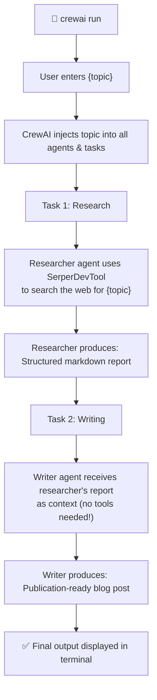

# 📚 CrewAI Learning Guide — Research & Blog Crew

> **For beginners.** This guide walks you through every concept in this project,
> from how agents think to how data flows between tasks.

---

## 📁 Project Structure

```
research_and_blog_crew/
├── agents/                               ← Agent definitions (one file per agent)
│   ├── senior_research_analyst.jsonc     ← Researcher: searches the web
│   └── tech_content_strategist__writ.jsonc ← Writer: creates blog posts
├── crew.jsonc                            ← Central crew config (tasks, process, inputs)
├── tools/                                ← Custom tools (empty for now)
├── knowledge/                            ← Knowledge files for agents
├── .env                                  ← API keys (NEVER commit to Git!)
├── pyproject.toml                        ← Python project config & dependencies
└── README.md
```

> [!IMPORTANT]
> This project uses the **JSON-first** format (CrewAI v1.15.28+). There are no
> `crew.py` or `main.py` files — everything is configured through JSONC files.
> The classic Python/YAML format (with `@agent`, `@task`, `@crew` decorators)
> is available via `crewai create crew --classic`.

---

## 🧠 Core Concepts

### 1. What is an Agent?

An **Agent** is an autonomous AI worker. Think of it as a team member with:

| Property | Purpose | Example |
|----------|---------|---------|
| `role` | Job title — tells the LLM "who it is" | "Senior Research Analyst" |
| `goal` | What it's trying to achieve | "Uncover cutting-edge developments on {topic}" |
| `backstory` | Personality & expertise | "You are an expert analyst known for..." |
| `llm` | The AI model powering its brain | `"groq/openai/gpt-oss-120b"` |
| `tools` | External capabilities (web search, etc.) | `["SerperDevTool"]` |

### 2. What is a Task?

A **Task** is a specific assignment given to an agent:

| Property | Purpose | Example |
|----------|---------|---------|
| `name` | Unique ID (used for context references) | `"conduct_thorough_research_on_task"` |
| `description` | What the agent should do | "Conduct thorough research on {topic}" |
| `expected_output` | Quality guide for the output | "A structured markdown report..." |
| `agent` | Who handles this task | `"senior_research_analyst"` |
| `context` | Dependencies on other tasks | `["conduct_thorough_research_on_task"]` |

### 3. What is a Crew?

A **Crew** is the orchestrator that brings agents and tasks together:

```
Crew = Agents + Tasks + Process + Inputs
```

---

## 🔄 How This Crew Executes (Step by Step)



### Detailed Execution Flow:

1. **You run** `crewai run` in the terminal
2. **CrewAI prompts** you for any missing `{placeholder}` values (like `{topic}`)
3. **Variables are injected** — `{topic}` is replaced everywhere in agent and task configs
4. **Task 1 starts** — The researcher agent activates:
   - It reads its role, goal, and backstory from `agents/senior_research_analyst.jsonc`
   - It has access to `SerperDevTool` (web search)
   - It runs in a **Thought → Action → Observation** loop:
     - **Thought**: "I need to search for information about {topic}"
     - **Action**: Uses SerperDevTool to search Google
     - **Observation**: Reads the search results
     - **Thought**: "I found key trends, let me search for more details..."
     - _(repeats until satisfied)_
   - It produces a structured markdown report
5. **Task 2 starts** — The writer agent activates:
   - It receives the researcher's FULL report as `context`
   - It has NO tools — it works entirely from the research data
   - It transforms the report into an engaging blog post
6. **Output is displayed** in the terminal

---

## 🔗 Task Chaining with `context`

This is one of the most important concepts in CrewAI:

```jsonc
// In crew.jsonc — Task 2 definition:
{
  "name": "using_the_research_report_task",
  "description": "Using the research report, write a blog post on {topic}...",
  "agent": "tech_content_strategist__writ",

  // 👇 THIS is the magic — task chaining!
  "context": ["conduct_thorough_research_on_task"]
}
```

**What `context` does:**
- Takes the **complete output** of `conduct_thorough_research_on_task`
- Injects it into the writer's prompt automatically
- The writer sees something like: _"Here is the context from previous tasks: [full research report]"_

**Without `context`**, the writer would have to do its own research (or hallucinate). **With `context`**, it has real data to work with.

You can chain **multiple tasks**:
```jsonc
"context": ["research_task", "analysis_task", "data_collection_task"]
```

---

## 🔧 Tools: Giving Agents Superpowers

### What are Tools?

Tools let agents interact with the outside world. Without tools, agents can only "think" using their LLM. With tools, they can:

- 🔍 **Search the web** (SerperDevTool)
- 🌐 **Scrape websites** (ScrapeWebsiteTool)
- 📄 **Read files** (FileReadTool)
- 💻 **Execute code** (CodeInterpreterTool)

### Built-in Tools (from `crewai-tools`)

| Tool | Description | Required API Key |
|------|-------------|-----------------|
| `SerperDevTool` | Google search via Serper.dev | `SERPER_API_KEY` |
| `ScrapeWebsiteTool` | Scrape content from URLs | None |
| `WebsiteSearchTool` | RAG-based website search | None |
| `FileReadTool` | Read local files | None |
| `DirectoryReadTool` | List directory contents | None |
| `PDFSearchTool` | Search within PDFs | None |
| `CodeInterpreterTool` | Run Python code | None |

### How Tools Work in JSON-first Projects

In JSONC files, reference tools by their **string name**:
```jsonc
// agents/my_agent.jsonc
{
  "tools": ["SerperDevTool", "ScrapeWebsiteTool"]
}
```

CrewAI automatically imports and instantiates them from the `crewai-tools` package.

### Custom Tools

Create your own tools in the `tools/` directory:
```jsonc
// Reference in agent JSONC:
{
  "tools": ["custom:my_tool"]
  // This loads tools/my_tool.py
}
```

---

## 🔑 Input Variables: The `{topic}` System

### How Inputs Flow Through the System

```
crewai run
    ↓
"Enter value for topic:" → "Agentic AI workflows in 2026"
    ↓
{topic} replaced in ALL files:
    ├── agents/senior_research_analyst.jsonc
    │   └── goal: "Uncover cutting-edge developments on Agentic AI workflows in 2026"
    ├── agents/tech_content_strategist__writ.jsonc
    │   └── goal: "Write a blog post on Agentic AI workflows in 2026"
    └── crew.jsonc (task descriptions)
        ├── Task 1: "Conduct thorough research on Agentic AI workflows in 2026"
        └── Task 2: "...write a blog post on Agentic AI workflows in 2026"
```

### Three Ways to Provide Inputs

1. **Interactive prompt** (default):
   ```bash
   crewai run
   # You'll be asked: "Enter value for topic:"
   ```

2. **Command-line flag**:
   ```bash
   crewai run --inputs '{"topic": "Agentic AI workflows in 2026"}'
   ```

3. **Default values** in `crew.jsonc`:
   ```jsonc
   "inputs": {
     "topic": "Agentic AI workflows in 2026"
   }
   ```

---

## 🔄 Sequential vs Hierarchical Process

### Sequential (used in this project)

```
Task 1 → Task 2 → Task 3 → Done
```
- Tasks run **in order**, one at a time
- Simple, predictable, easy to debug
- Best for **linear workflows** (research → write → edit)

### Hierarchical

```
        Manager Agent
       /     |      \
   Task A  Task B  Task C
```
- A **manager agent** delegates tasks dynamically
- More flexible, but harder to predict
- Requires `"manager_llm"` configuration
- Best for **complex workflows** where order depends on results

---

## 🆚 JSON-first vs Classic (Python/YAML) Format

This project uses the **JSON-first** format. Here's how it compares:

| Feature | JSON-first (this project) | Classic (`--classic`) |
|---------|--------------------------|----------------------|
| Agent definitions | `agents/*.jsonc` | `config/agents.yaml` + `crew.py` |
| Task definitions | `crew.jsonc` | `config/tasks.yaml` + `crew.py` |
| Entry point | `crewai run` (auto) | `main.py` → `crew.py` |
| Tool assignment | `"tools": ["SerperDevTool"]` | `tools=[SerperDevTool()]` in Python |
| Context/chaining | `"context": ["task_name"]` | `context=[self.task_name()]` in Python |
| Decorators | Not used | `@agent`, `@task`, `@crew`, `@CrewBase` |
| Customization | Edit JSONC files only | Full Python control |

### What the Classic Format Looks Like

For reference, here's what this same crew would look like in the classic Python/YAML format:

**`config/agents.yaml`**:
```yaml
researcher:
  role: >
    Senior Research Analyst
  goal: >
    Uncover cutting-edge developments and key insights on {topic}
  backstory: >
    You are an expert analyst known for extracting actionable facts...

writer:
  role: >
    Tech Content Strategist & Writer
  goal: >
    Write an engaging blog post based on research findings on {topic}
  backstory: >
    You are a skilled technical writer...
```

**`crew.py`** (with educational comments):
```python
from crewai import Agent, Crew, Process, Task
from crewai.project import CrewBase, agent, crew, task
from crewai_tools import SerperDevTool

# @CrewBase is a class decorator that:
#   - Auto-discovers config/agents.yaml and config/tasks.yaml
#   - Sets up the self.agents_config and self.tasks_config dictionaries
#   - Enables the @agent, @task, @crew decorators below
@CrewBase
class ResearchAndBlogCrew:
    """Research and Blog crew."""

    # @agent decorator: Registers this method as an agent factory.
    # The method name MUST match a key in agents.yaml.
    # CrewAI calls this method to create the agent instance.
    @agent
    def researcher(self) -> Agent:
        return Agent(
            config=self.agents_config["researcher"],  # type: ignore[index]
            tools=[SerperDevTool()],  # Instantiate tools here
            verbose=True,
        )

    @agent
    def writer(self) -> Agent:
        return Agent(
            config=self.agents_config["writer"],  # type: ignore[index]
            verbose=True,
            # No tools! Gets data via context.
        )

    # @task decorator: Registers this method as a task factory.
    # The method name MUST match a key in tasks.yaml.
    @task
    def research_task(self) -> Task:
        return Task(
            config=self.tasks_config["research_task"],  # type: ignore[index]
        )

    @task
    def writing_task(self) -> Task:
        return Task(
            config=self.tasks_config["writing_task"],  # type: ignore[index]
            # context= receives output from research_task
            context=[self.research_task()],
        )

    # @crew decorator: Assembles the final Crew object.
    # self.agents and self.tasks are auto-populated by @CrewBase
    # from all @agent and @task decorated methods.
    @crew
    def crew(self) -> Crew:
        return Crew(
            agents=self.agents,    # All @agent methods → list of Agent objects
            tasks=self.tasks,      # All @task methods → list of Task objects
            process=Process.sequential,
            verbose=True,
        )
```

**`main.py`** (with educational comments):
```python
#!/usr/bin/env python
from research_and_blog_crew.crew import ResearchAndBlogCrew

def run():
    # inputs dict → {topic} placeholder in YAML files
    inputs = {"topic": "Agentic AI workflows in 2026"}
    # .crew() creates the Crew, .kickoff() starts execution
    ResearchAndBlogCrew().crew().kickoff(inputs=inputs)

if __name__ == "__main__":
    run()
```

---

## 🚀 Running Your Crew

### Prerequisites

1. ✅ Python 3.10–3.13 installed
2. ✅ `uv` package manager installed
3. ✅ `GROQ_API_KEY` set in `.env` (already done)
4. ⬜ `SERPER_API_KEY` set in `.env` (**you need to do this!**)

### Step 1: Get Your Serper API Key

1. Go to [serper.dev](https://serper.dev)
2. Sign up (free tier: 2,500 searches)
3. Copy the API key
4. Open `.env` and replace `your_serper_api_key_here` with your key

### Step 2: Run the Crew

```bash
# Navigate to the project
cd c:\Users\super.user\projects\CrewAI\research_and_blog_crew

# Run with interactive topic prompt:
crewai run

# Or run with a specific topic directly:
crewai run --inputs '{"topic": "Agentic AI workflows in 2026"}'
```

### Step 3: Watch the Output

With `verbose: true`, you'll see the full agent reasoning:

```
 [2026-10-15 01:00:00][INFO]: == Working Agent: Senior Research Analyst
 [2026-10-15 01:00:00][INFO]: == Starting Task: Conduct thorough research on Agentic AI workflows in 2026...

> Thought: I need to search for the latest information about Agentic AI workflows.
> Action: SerperDevTool
> Action Input: {"query": "Agentic AI workflows 2026 trends"}
> Observation: [search results appear here]
> Thought: I found some key trends. Let me search for more specifics...
...

 [2026-10-15 01:02:00][INFO]: == Working Agent: Tech Content Strategist & Writer
 [2026-10-15 01:02:00][INFO]: == Starting Task: Using the research report, write an engaging blog post...

> Thought: I have a comprehensive research report. Let me structure this into 4 sections...
```

### Useful Commands

```bash
# Test the crew (runs multiple iterations with evaluation)
crewai test

# Enable trace collection for debugging
crewai traces enable

# View outputs from the last run
crewai log-tasks-outputs

# Reset all agent memories
crewai reset-memories -a
```

---

## 🔍 Troubleshooting

| Problem | Cause | Fix |
|---------|-------|-----|
| `SERPER_API_KEY not found` | Missing API key in `.env` | Add your key from serper.dev |
| `Model not found` | Wrong model name or missing API key | Check `GROQ_API_KEY` is valid |
| `Agent stuck in loop` | Too many iterations without progress | Add `"max_iter": 15` to agent settings |
| `Empty output` | Description too vague | Make task descriptions more specific |
| `Rate limit exceeded` | Too many API calls | Add `"max_rpm": 10` to agent settings |

---

## 📖 Further Reading

- [CrewAI Documentation](https://docs.crewai.com)
- [CrewAI Tools Reference](https://docs.crewai.com/concepts/tools)
- [Serper.dev (search API)](https://serper.dev)
- [Groq Console (LLM API)](https://console.groq.com)
- [CrewAI GitHub](https://github.com/crewAIInc/crewAI)

---

> **Tip:** Once you're comfortable with this two-agent crew, try:
> 1. Adding a third agent (e.g., an "Editor" that reviews the blog post)
> 2. Using `"process": "hierarchical"` with a manager agent
> 3. Creating custom tools in the `tools/` directory
> 4. Enabling memory with `"memory": true` for cross-run learning
