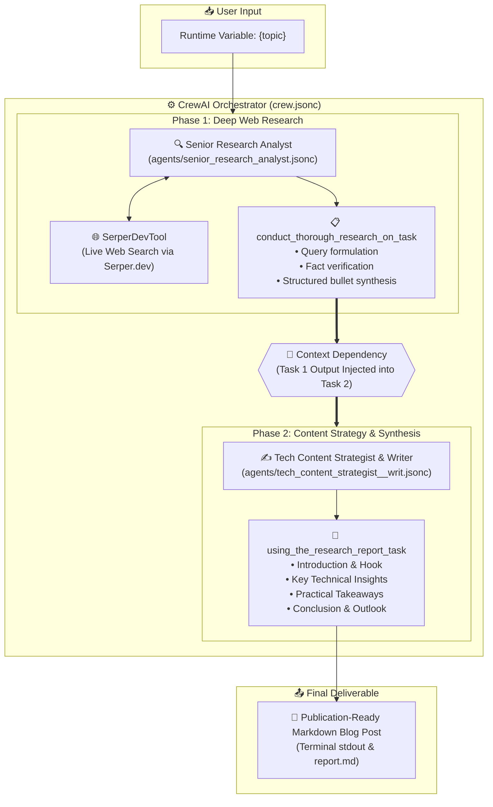

# 🤖 CrewAI Research & Blog Writer Multi-Agent System

<div align="center">

[](https://www.python.org/)
[](https://crewai.com)
[](https://litellm.ai)
[](LICENSE)
[](https://github.com/muhammadumarafzaal/crewai-research-writer/pulls)

**An autonomous, multi-agent AI pipeline built with CrewAI's declarative JSON-first architecture.**  
*Performs live web research on any technical topic and synthesizes an engaging, publication-ready blog post.*

[Key Features](#-key-features) •
[Architecture](#-system-architecture) •
[Quickstart](#-quickstart-guide) •
[Configuration](#-configuration--parameters) •
[Troubleshooting](#-troubleshooting--faq)

</div>

---

## 🌟 Overview

The **CrewAI Research & Blog Writer** is an enterprise-grade multi-agent workflow engineered to demonstrate collaborative agentic AI. Rather than relying on a single monolithic prompt, this system orchestrates a specialized crew of two autonomous agents that communicate through structured context handoffs:

1. **Senior Research Analyst**: Equipped with real-time web search capabilities (`SerperDevTool`), this agent navigates live web resources, identifies market trends, extracts key technical facts, and structures findings into an exhaustive research brief.
2. **Tech Content Strategist & Writer**: Operating with a zero-tool policy, this agent ingests the researcher's output via strict context chaining, translating technical data into an engaging, structured 4-section article suitable for engineering blogs.

This project emphasizes **separation of concerns**, **deterministic task chaining**, and **declarative configuration** via JSON/JSONC.

---

## 🏗 System Architecture

The pipeline follows a deterministic **Sequential Process**, ensuring strict chronological execution and dependable context transmission between agents.



### 🧠 Agent Roles & Responsibilities

| Agent | Core Role | Tools | Primary Goal | Input Dependency |
| :--- | :--- | :--- | :--- | :--- |
| **Senior Research Analyst** | Fact Mining & Trend Identification | `SerperDevTool` | Uncover cutting-edge developments, challenges, and future outlook for `{topic}`. | Initial `{topic}` parameter |
| **Tech Content Strategist & Writer** | Synthesis & Technical Storytelling | *None (Zero-tool)* | Craft an engaging, structured 4-section blog post using research context. | Research task output (`context`) |

> **Why the Writer has no tools:**  
> Giving writing agents web search tools leads to hallucinations, scope drift, and redundant API calls. Constraining the writer to the researcher's output guarantees that the article is 100% grounded in verified source facts.

---

## ✨ Key Features

- **Declarative JSON-First Configuration**: Agents and tasks are configured in human-readable `.jsonc` files with extensive inline documentation and syntax support.
- **Dynamic Variable Interpolation**: Use `{topic}` throughout prompts, goals, and descriptions, populated interactively or via CLI flags.
- **Native & LiteLLM Integration**: Seamlessly switch between **Groq**, **OpenAI**, **Anthropic**, **Gemini**, **Ollama**, or **DeepSeek** by changing a single environment variable.
- **Real-Time Web Grounding**: Integrated Google Search API via `SerperDevTool` ensures insights reflect the latest technical developments.
- **Traceable Reasoning Loops**: Verbose logging displays the entire agent thought cycle:
  $$\text{Thought} \longrightarrow \text{Action} \longrightarrow \text{Observation} \longrightarrow \text{Final Answer}$$
- **Modular Directory Architecture**: Clean separation between configurations, custom Python tools (`tools/`), domain knowledge (`knowledge/`), and skills (`skills/`).

---

## 📁 Repository Structure

```
crewai-research-writer/
├── .env.example                          # Template for API keys and model configurations
├── .gitignore                            # Comprehensive exclusions (.venv, secrets, cache)
├── AGENTS.md                             # Architectural specification & agent guidelines
├── CLAUDE.md                             # IDE instruction config for Claude Code
├── CURSOR.md                             # IDE instruction config for Cursor
├── GEMINI.md                             # IDE instruction config for Google Antigravity/Gemini
├── LEARNING_GUIDE.md                     # Deep-dive educational tutorial on CrewAI concepts
├── README.md                             # Production project documentation
├── pyproject.toml                        # Project metadata, dependencies, and build specs
├── uv.lock                               # Deterministic dependency lockfile
│
├── agents/                               # Declarative agent definitions (JSONC)
│   ├── senior_research_analyst.jsonc     # Researcher persona, goals, SerperDevTool config
│   └── tech_content_strategist__writ.jsonc # Writer persona, storytelling guidelines
│
├── crew.jsonc                            # Central orchestrator: tasks, sequencing, context
├── knowledge/                            # Static domain knowledge accessible to agents
│   └── user_preference.txt               # Formatting and style constraints
├── skills/                               # Extended custom capabilities
│   └── .gitkeep
└── tools/                                # Custom Python tool implementations
    └── .gitkeep
```

---

## 🚀 Quickstart Guide

### 1. Prerequisites

- **Python**: Version `3.10` or higher (`3.11` recommended)
- **uv** (Recommended modern Python packager) or standard `pip`
  ```bash
  # Install uv (if not already installed)
  curl -LsSf https://astral.sh/uv/install.sh | sh      # macOS / Linux
  powershell -c "irm https://astral.sh/uv/install.ps1 | iex" # Windows
  ```
- **API Keys**:
  - **Groq API Key**: [Get a free Groq key](https://console.groq.com/keys) (ultra-fast inference)
  - **Serper API Key**: [Get a free Serper key](https://serper.dev) (2,500 free Google searches)

---

### 2. Installation

1. **Clone the repository:**
   ```bash
   git clone https://github.com/muhammadumarafzaal/crewai-research-writer.git
   cd crewai-research-writer
   ```

2. **Set up virtual environment & install dependencies:**
   ```bash
   # Using uv (fast & recommended)
   uv sync

   # Or using standard pip
   python -m venv .venv
   # Windows:
   .venv\Scripts\activate
   # Linux/macOS:
   source .venv/bin/activate
   pip install -e ".[litellm,tools]"
   ```

---

### 3. Environment Configuration

Copy the sample environment file and configure your API keys:

```bash
# On Linux / macOS:
cp .env.example .env

# On Windows PowerShell:
Copy-Item .env.example .env
```

Open `.env` and fill in your keys:

```ini
# LLM Model identifier (provider/model-name)
# Supported examples:
#   groq/llama-3.3-70b-versatile
#   openai/gpt-4o
#   anthropic/claude-3-5-sonnet-20241022
MODEL=groq/llama-3.3-70b-versatile

# Groq API Key (Powers the LLM)
GROQ_API_KEY=gsk_your_groq_api_key_here

# Serper.dev API Key (Powers live web search)
SERPER_API_KEY=your_serper_dev_api_key_here
```

---

### 4. Running the Multi-Agent Crew

#### Option A: Interactive Mode (Recommended)
Run the crew without arguments; CrewAI will automatically prompt you for the `{topic}`:

```bash
crewai run
```
```
? Enter value for topic: Agentic AI workflows in 2026
```

#### Option B: Command-Line Argument Mode

- **Bash / Linux / macOS:**
  ```bash
  crewai run --inputs '{"topic": "Quantum Computing Advances in 2026"}'
  ```

- **Windows PowerShell:**
  *(Note: PowerShell requires escaping inner quotation marks)*
  ```powershell
  crewai run --inputs "{\`"topic\`": \`"Quantum Computing Advances in 2026\`"}"
  ```

---

## ⚙️ Configuration & Parameters

### Agent Definition (`agents/*.jsonc`)

Agents are configured with declarative attributes:

```jsonc
{
  "role": "Senior Research Analyst",
  "goal": "Uncover cutting-edge developments and key insights on {topic}",
  "backstory": "You are an expert analyst known for extracting actionable facts...",
  "llm": "groq/llama-3.3-70b-versatile",
  "tools": ["SerperDevTool"],
  "settings": {
    "verbose": true,         // Outputs live thought process
    "allow_delegation": false, // Keeps agent execution linear
    "planning": true          // Creates a step-by-step plan prior to execution
  }
}
```

### Orchestration & Context Chaining (`crew.jsonc`)

Tasks define dependencies through the `"context"` field:

```jsonc
{
  "name": "research_and_blog_crew",
  "agents": ["senior_research_analyst", "tech_content_strategist__writ"],
  "tasks": [
    {
      "name": "conduct_thorough_research_on_task",
      "description": "Conduct thorough research on {topic}...",
      "expected_output": "A structured markdown report with key findings...",
      "agent": "senior_research_analyst"
    },
    {
      "name": "using_the_research_report_task",
      "description": "Using the research report, write an engaging 4-section blog post...",
      "expected_output": "A complete, publication-ready markdown blog post.",
      "agent": "tech_content_strategist__writ",
      // Task 2 receives the full output from Task 1
      "context": ["conduct_thorough_research_on_task"]
    }
  ],
  "process": "sequential",
  "verbose": true
}
```

---

## 🛠 Adding Custom Tools

To extend the researcher or writer with custom capabilities (e.g., querying an internal database or custom API):

1. Create a Python script in `tools/`, e.g., `tools/fetch_trends.py`:
   ```python
   from crewai.tools import tool

   @tool("Fetch Trends Tool")
   def fetch_trends(topic: str) -> str:
       """Fetches real-time market buzz for a given topic."""
       return f"Top trending discussions for {topic}: [Autonomous Agents, Local SLMs]"
   ```
2. Reference the tool in your agent's JSONC:
   ```jsonc
   "tools": ["custom:fetch_trends"]
   ```

---

## ❓ Troubleshooting & FAQ

<details>
<summary><b>1. Error: <code>Unable to initialize LLM ... LiteLLM fallback package is not installed</code></b></summary>
<br>
When using non-native providers (like Groq), CrewAI uses LiteLLM under the hood. Install the LiteLLM extra:

```bash
uv add "crewai[litellm]"
# or
pip install litellm
```
</details>

<details>
<summary><b>2. PowerShell <code>Error: Got unexpected extra arguments</code></b></summary>
<br>
PowerShell parses single quotes differently than Unix shells. Use backtick-escaped double quotes:

```powershell
crewai run --inputs "{\`"topic\`": \`"Your Topic Here\`"}"
```
Or simply run `crewai run` and enter the topic when prompted.
</details>

<details>
<summary><b>3. Serper API Rate Limits or HTTP 403</b></summary>
<br>
Ensure your `SERPER_API_KEY` is correctly defined in your `.env` file without quotes or spaces:

```ini
SERPER_API_KEY=your_actual_key_here
```
Verify your remaining credits on the [Serper Dashboard](https://serper.dev).
</details>

<details>
<summary><b>4. Rate limiting on free LLM tiers</b></summary>
<br>
If you hit rate limits on Groq's free tier, adjust the model in `.env` to a lighter model like `groq/llama-3.1-8b-instant`, or introduce an OpenAI/Anthropic fallback.
</details>

---

## 🤝 Contributing

Contributions are welcomed! Follow these steps to contribute:

1. **Fork the Repository**
2. **Create a Feature Branch** (`git checkout -b feature/AmazingFeature`)
3. **Commit your Changes** (`git commit -m 'feat: add AmazingFeature'`)
4. **Push to the Branch** (`git push origin feature/AmazingFeature`)
5. **Open a Pull Request**

---

## 📜 License

Distributed under the **MIT License**. See `LICENSE` for more information.

---

## 👤 Author

**Muhammad Umar Afzaal**
- GitHub: [@muhammadumarafzaal](https://github.com/muhammadumarafzaal)
- Email: [umarafzaal182@gmail.com](mailto:umarafzaal182@gmail.com)

<div align="center">
  <sub>Built with ❤️ using CrewAI, LiteLLM, and Groq.</sub>
</div>
